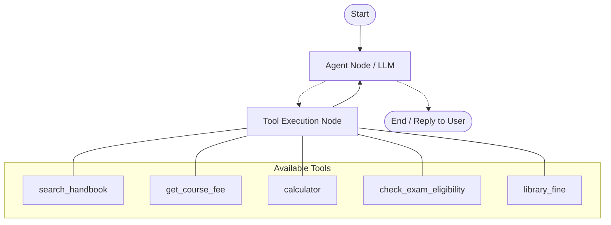

# Extended College Helpdesk Agent (Day 8 In-Class Task)

An agentic Retrieval-Augmented Generation (RAG) system built with **LangGraph**, **LangChain**, and **ChromaDB** that serves as an intelligent helpdesk for Greenfield College of Engineering. The agent can answer policy questions, calculate fees, evaluate exam eligibility from attendance percentages, preserve conversational memory across turns, and drop weak out-of-domain queries using cosine distance relevance guards.

---

## 🏛️ Architecture & Workflow

The agent runs as a stateful loop in LangGraph with in-memory persistence (`InMemorySaver`), enabling multi-turn conversations and tool execution.



- **LLM Provider:** Groq (`openai/gpt-oss-120b`)
- **Embedding Model:** `BAAI/bge-small-en-v1.5` via `fastembed` (384-dimensional dense vectors)
- **Vector Store:** ChromaDB (`hnsw:space = cosine`)
- **Memory:** `langgraph.checkpoint.memory.InMemorySaver`

---

## 🚀 What Was Implemented

### 📄 Part A – New Document & Re-Ingestion
- **Document Created:** `data/placement_policy.md` containing official placement rules:
  - CGPA requirement: $\ge 6.5$ with no standing arrears.
  - Registration deadline: before 31 July of the final year.
  - Pre-placement training attendance: minimum $90\%$.
  - "One student, one job" rule ($6\text{ LPA}$ cap, $1.5\times$ dream offer).
- **Ingestion (`1_ingest.py`):**
  - Expanded corpus from 5 to **6 documents**.
  - Split into **27 chunks** (`chunk_size=300, chunk_overlap=50`).
- **Search Verification (`2_search.py`):**
  - Confirmed query *"What CGPA do I need to be eligible for placements?"* ranks `placement_policy.md` as top result with cosine distance `0.177`.

---

### 🛠️ Part B – Exam Eligibility Tool (`check_exam_eligibility`)
Implemented a deterministic tool in [`task_agent.py`](file:///c:/Users/Anu%20Priya/Desktop/AI%20Training%20-%20Practice/ps1/task_agent.py) following Greenfield College examination regulations:
- **Input Validation:** Rejects values $< 0$ or $> 100$ with an informative error message (no exceptions raised).
- **$\ge 75\%$:** Returns `ELIGIBLE` to write the end-semester examination.
- **$65\% \le \text{Attendance} < 75\%$:** Returns `CONDONATION` allowed upon paying Rs. 500 per course with a medical or official certificate.
- **$< 65\%$:** Returns `NOT ELIGIBLE` (student must redo course).

#### Unit Test Evidence:
```text
check_exam_eligibility(82)  -> ELIGIBLE: With 82.0% attendance...
check_exam_eligibility(70)  -> CONDONATION: With 70.0% attendance... Rs. 500 per course...
check_exam_eligibility(50)  -> NOT ELIGIBLE: With 50.0% attendance (below 65%)...
check_exam_eligibility(120) -> Error: Attendance percentage 120.0 is invalid. It must be between 0 and 100.
```

---

### 🛡️ Part C – Vector Relevance Guard
Prevented hallucination and out-of-domain answers by guarding `search_handbook`:
1. Utilized `store.similarity_search_with_score(query, k=3)`.
2. Empirically measured cosine distance thresholds:
   - **Placements question (in-domain):** `0.1768` (`placement_policy.md`)
   - **Capital of France (out-of-domain):** `0.5731` (`hostel_rules.md`)
3. **Selected Threshold:** `MAX_DISTANCE = 0.40`.
4. If no chunk satisfies MAX\_DISTANCE, the tool returns:
   ```text
   NO_MATCH: this is not covered in the college handbook
   ```
5. Prompted the agent: If `search_handbook` returns `NO_MATCH`, respond with *"I don't know"*.

---

### 🧪 Part D – Multi-Turn Testing & Results

All 5 benchmark questions were executed in a single thread (`thread_id="task-run"`):

| # | Question | Tools Called (in order) | Agent's Answer (short) | Correct? |
|---|----------|-------------------------|------------------------|:--------:|
| 1 | *What CGPA do I need to be eligible for placements?* | `search_handbook` | CGPA 6.5 or higher and no standing arrears (`placement_policy.md`) | **Y** |
| 2 | *My attendance is 70%. Can I write the exam?* | `check_exam_eligibility` | Eligible with condonation: pay Rs. 500 per course with certificate | **Y** |
| 3 | *What is the total of the CS101 fee, the AI202 fee and the maximum late fee?* | `search_handbook`, `get_course_fee`, `get_course_fee`, `calculator` | Rs. 32,000 (12,000 + 18,000 + 2,000) | **Y** |
| 4 | *And if I pay only 5 days late instead?* | `calculator` | Rs. 30,500 (Uses Q3 memory: 12,000 + 18,000 + 500) | **Y** |
| 5 | *What is the capital of France?* | `search_handbook` (returned `NO_MATCH`) | "I don't know - not in handbook" | **Y** |

---

### 🌟 Bonus & Stretch Goals

1. **Thread Memory Isolation Experiment:**
   - In thread `task-run`, asking *"And if I pay only 5 days late instead?"* directly uses Q3 context from memory to compute **Rs. 30,500**.
   - In a fresh thread `task-run-2`, asking the exact same question in isolation triggers a search for the late fee policy only and calculates **Rs. 500** (5 days × Rs. 100), because thread `task-run-2` has no memory of the courses mentioned in `task-run`.
   - Empirically verifies thread isolation in LangGraph (`task-run` has 26 messages saved; `task-run-2` has 4 messages saved).
2. **`library_fine` Tool:**
   - Implemented `@tool def library_fine(days_late: int, books: int = 1)` calculating fine according to `library.md`.

---

## 📁 Repository Structure

```text
ps1/ (and day8_task/)
│
├── data/                                # Knowledge base markdown files
│   ├── ai_fluency_training.md
│   ├── exam_regulations.md
│   ├── fee_policy.md
│   ├── hostel_rules.md
│   ├── library.md
│   └── placement_policy.md             # [Part A] New placement policy
│
├── 1_ingest.py                          # Chunker & vector embedding pipeline
├── 2_search.py                          # Vector similarity search verification
├── 3_rag_chain.py                       # Exercise 3 RAG LCEL chain
├── 4_graph_basics.py                    # Exercise 4 LangGraph basics
├── 5_agentic_rag.py                     # Original Exercise 5 lab file (kept intact)
├── task_agent.py                        # [Parts B, C, D] Extended Agentic RAG script
├── lc_config.py                         # LLM & Embedding provider configuration
├── results.md                           # Comprehensive evaluation report & evidence
├── run_log.txt                          # Complete execution transcript of task_agent.py
└── README.md                            # Documentation
```

---

## 🏃 How to Run

1. **Set up environment variables (`.env`):**
   ```env
   PROVIDER=groq
   GROQ_API_KEY=your_groq_api_key
   MODEL=openai/gpt-oss-120b
   EMBED_PROVIDER=fastembed
   EMBED_MODEL=BAAI/bge-small-en-v1.5
   ```

2. **Ingest documents into ChromaDB:**
   ```bash
   python 1_ingest.py
   ```

3. **Verify vector search:**
   ```bash
   python 2_search.py
   ```

4. **Run the agent & generate log:**
   ```bash
   python task_agent.py > run_log.txt
   ```
